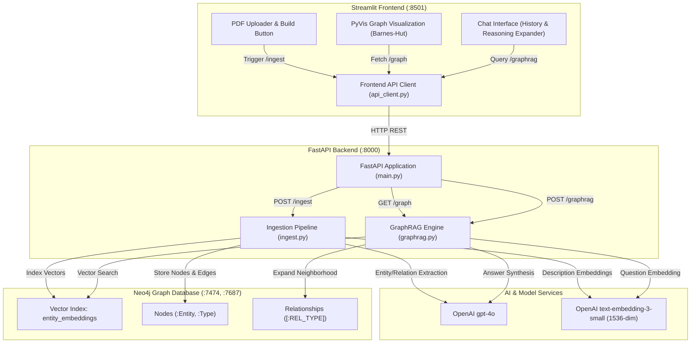

# GraphRAG Knowledge Graph Explorer with Streamlit and Neo4j

A production-grade full-stack application to construct, query, and explore knowledge graphs from PDF documents using Large Language Models (LLMs) and Graph Retrieval-Augmented Generation (GraphRAG).

The system integrates **FastAPI**, **Neo4j** (native graph database with vector indexing), **Streamlit** (interactive visualization with PyVis), and **OpenAI** (`gpt-4o` and `text-embedding-3-small`).

---

## 🌟 Key Features

- **Automated PDF Knowledge Extraction**: Text extraction via `pdfplumber`, text chunking, and structured entity/relationship extraction using LLMs.
- **Hybrid Graph & Vector Storage**: Persists labeled entity nodes, directional typed relationships, and 1536-dimensional embeddings in Neo4j.
- **Neo4j Vector Indexing**: Creates and utilizes the `entity_embeddings` cosine vector index for semantic retrieval.
- **Two-Stage GraphRAG Pipeline**:
  1. *Vector Search*: Identifies top anchor entities using semantic similarity.
  2. *Subgraph Neighborhood Expansion*: Gathers connected 1-hop and 2-hop graph relations.
  3. *Context Grounding & Synthesis*: Synthesizes grounded, verifiable answers.
- **Interactive Visual Explorer**: Visualizes the top connected subgraph using PyVis physics simulation with color-coded entity types and metrics.
- **Streamlit Chat Interface**: Provides conversational QA with an expandable "View reasoning" panel showing anchor nodes and graph context.
- **Single-Command Docker Orchestration**: Containerized multi-service setup (`neo4j`, `backend`, `frontend`) with health checks and volume persistence.

---

## 📐 Architecture Overview



---

## 📂 Project Structure

```
.
├── docker-compose.yml          # Multi-container orchestration (neo4j, backend, frontend)
├── .env.example                # Template for environment variables
├── .env                        # Local environment configuration (git-ignored)
├── README.md                   # Complete documentation
├── data/
│   └── pdfs/                   # Directory for storing input PDF files
│       └── sample_graphrag_overview.pdf
├── backend/
│   ├── Dockerfile              # Backend container build instructions
│   ├── main.py                 # FastAPI application and route endpoints
│   ├── ingest.py               # PDF extraction, chunking, LLM extraction & Neo4j upsert
│   ├── graphrag.py             # Vector anchor search, subgraph expansion & QA synthesis
│   └── requirements.txt        # Backend dependencies
└── frontend/
    ├── Dockerfile              # Frontend container build instructions
    ├── app.py                  # Streamlit application UI (Tabs, PyVis, Chat)
    ├── api_client.py           # Centralized HTTP client for backend communication
    └── requirements.txt        # Frontend dependencies
```

---

## ⚙️ Environment Variables

Create your `.env` file from `.env.example`:

```bash
cp .env.example .env
```

Ensure the following variables are configured:

| Variable | Description | Default / Example |
| :--- | :--- | :--- |
| `OPENAI_API_KEY` | OpenAI API key for `gpt-4o` and `text-embedding-3-small` | `sk-...` |
| `NEO4J_URI` | Bolt connection URI for Neo4j database | `bolt://neo4j:7687` |
| `NEO4J_USER` | Neo4j authentication username | `neo4j` |
| `NEO4J_PASSWORD` | Neo4j authentication password | `password` |
| `BACKEND_URL` | Base URL used by Streamlit frontend to reach FastAPI | `http://backend:8000` |

---

## 🚀 Docker Implementation & Commands Guide

### 1. Launch All Services (One-Command Start)

Build images and launch `neo4j`, `backend`, and `frontend` containers:

```bash
docker-compose up --build
```

To run in the background (detached mode):

```bash
docker-compose up -d --build
```

### 2. Check Service Health & Status

View all running containers, port mappings, and healthcheck states:

```bash
docker-compose ps
```

Expected health states:
- `graphrag_neo4j`: `Up (healthy)`
- `graphrag_backend`: `Up (healthy)`
- `graphrag_frontend`: `Up`

### 3. View Service Logs

Follow logs in real time:

```bash
# All services
docker-compose logs -f

# Backend API logs only
docker-compose logs -f backend

# Frontend Streamlit logs only
docker-compose logs -f frontend

# Neo4j database logs only
docker-compose logs -f neo4j
```

### 4. Interactive Container Shell Access

Access container environments for debugging:

```bash
# Backend container shell
docker exec -it graphrag_backend /bin/bash

# Neo4j Cypher Shell inside container
docker exec -it graphrag_neo4j cypher-shell -u neo4j -p password

# Frontend container shell
docker exec -it graphrag_frontend /bin/bash
```

### 5. Inspect Neo4j Vector Index & Graph from Terminal

Query Neo4j directly via `cypher-shell`:

```bash
# Verify vector index exists and is ONLINE
docker exec -it graphrag_neo4j cypher-shell -u neo4j -p password "SHOW INDEXES WHERE name = 'entity_embeddings';"

# Inspect top 10 nodes and their labels
docker exec -it graphrag_neo4j cypher-shell -u neo4j -p password "MATCH (n) RETURN labels(n), n.name, n.type, size(n.embedding) LIMIT 10;"

# Inspect relationships
docker exec -it graphrag_neo4j cypher-shell -u neo4j -p password "MATCH ()-[r]->() RETURN type(r) LIMIT 10;"
```

### 6. Test Backend Endpoints via curl (From Host)

```bash
# Health check
curl -X GET http://localhost:8000/health

# Trigger PDF Ingestion
curl -X POST http://localhost:8000/ingest \
  -H "Content-Type: application/json" \
  -d "{\"pdf_dir\": \"/data/pdfs/\"}"

# Fetch Top Graph Subgraph
curl -X GET "http://localhost:8000/graph?limit=10"

# Query GraphRAG
curl -X POST http://localhost:8000/graphrag \
  -H "Content-Type: application/json" \
  -d "{\"question\": \"What is Backpropagation?\"}"
```

### 7. Stopping and Teardown

```bash
# Stop containers without removing volumes
docker-compose down

# Stop containers and wipe volumes (reset database)
docker-compose down -v

# Rebuild without Docker cache
docker-compose build --no-cache
```

### 8. Services Access URLs

- **Streamlit Frontend**: [http://localhost:8501](http://localhost:8501)
- **FastAPI Documentation & Swagger UI**: [http://localhost:8000/docs](http://localhost:8000/docs)
- **Neo4j Browser Console**: [http://localhost:7474](http://localhost:7474) (Username: `neo4j`, Password: `password`)

---

## 📡 API Contract Specification

### 1. Ingest Documents (`POST /ingest`)
Scans `pdf_dir`, extracts text via `pdfplumber`, performs LLM entity/relation extraction, computes 1536-dimensional embeddings, and indexes into Neo4j.

- **Request Body**:
  ```json
  {
    "pdf_dir": "/data/pdfs/"
  }
  ```
- **Response Body (200 OK)**:
  ```json
  {
    "status": "success",
    "nodes_created": 15,
    "edges_created": 20,
    "files_processed": 1
  }
  ```

### 2. Graph Subgraph Retrieval (`GET /graph`)
Returns the top connected nodes ordered by degree and the edges connecting them.

- **Query Parameters**:
  - `limit` (integer, optional, default: `50`): Max nodes to return.
- **Response Body (200 OK)**:
  ```json
  {
    "nodes": [
      {
        "id": "e4f8a2c1-...",
        "name": "GraphRAG",
        "type": "Technology",
        "description": "Graph Retrieval-Augmented Generation system..."
      }
    ],
    "edges": [
      {
        "source": "e4f8a2c1-...",
        "target": "b2c3d4e5-...",
        "relation": "USES"
      }
    ]
  }
  ```

### 3. GraphRAG Question Answering (`POST /graphrag`)
Performs question embedding, vector similarity retrieval for anchor nodes, traverses graph neighborhood, and synthesizes grounded answers.

- **Request Body**:
  ```json
  {
    "question": "What is backpropagation and how does it relate to gradient descent?"
  }
  ```
- **Response Body (200 OK)**:
  ```json
  {
    "question": "What is backpropagation and how does it relate to gradient descent?",
    "anchor_nodes": [
      {
        "name": "Backpropagation",
        "type": "Algorithm",
        "score": 0.942
      },
      {
        "name": "Gradient Descent",
        "type": "Algorithm",
        "score": 0.887
      }
    ],
    "subgraph_context": "=== Anchor Nodes ===\n- Backpropagation [Algorithm] (similarity: 0.94)...",
    "answer": "Backpropagation is a supervised learning algorithm that computes gradients of the loss function..."
  }
  ```

---

## 🧠 Database Schema & Indexing

### Nodes
- **Labels**: Labeled with both `:Entity` and their specific entity type (e.g. `:Algorithm`, `:Concept`, `:Technology`).
- **Properties**:
  - `id`: UUID string
  - `name`: String identifier
  - `type`: String category
  - `description`: Textual definition or context
  - `embedding`: 1536-dimensional float vector

### Relationships
- **Type**: Formatted UPPERCASE identifier representing the relation (e.g., `USED_IN`, `IMPLEMENTS`, `CONNECTED_TO`).

### Vector Index
- **Index Name**: `entity_embeddings`
- **Definition**:
  ```cypher
  CREATE VECTOR INDEX entity_embeddings IF NOT EXISTS
  FOR (n:Entity) ON (n.embedding)
  OPTIONS {indexConfig: {
    `vector.dimensions`: 1536,
    `vector.similarity_function`: 'cosine'
  }}
  ```

---

## 🧪 Local Testing & Verification

Run automated test suite:

```bash
pytest tests/ -v
```
